**AntelopeJS DMS is the open-source back office for your product.** 
Connect your PostgreSQL, MongoDB or RethinkDB database. Your coding agent builds the admin pages and a dashboard, as TypeScript in your repo.

 

[Live demo](https://dms-demo.antelopejs.com) · [DMS docs](https://dms.antelopejs.com/docs) · [Framework docs](https://framework.antelopejs.com/docs) · [Roadmap](https://github.com/orgs/AntelopeJS/projects)

## Products

- **[AntelopeJS DMS](https://github.com/AntelopeJS/dms)**, open source. Connect your database, get the back office and a dashboard as TypeScript in your repo. [Docs](https://dms.antelopejs.com/docs)
- **[AntelopeJS framework](https://github.com/AntelopeJS/antelopejs)**, open source. The TypeScript runtime and `ajs` CLI: modules depend on contracts, and you choose which provider runs. [Docs](https://framework.antelopejs.com/docs)
- **[AntelopeJS Cloud](https://cloud.antelopejs.com)**, waitlist. Managed hosting for AntelopeJS applications, and the only paid part of AntelopeJS.

<b>Watch the films</b>

**A tour of AntelopeJS DMS.**

https://github.com/user-attachments/assets/ba552792-f0d4-4fcf-8b0e-81029a5a2582

**AntelopeJS Cloud.**

https://github.com/user-attachments/assets/d189468b-5148-4d6f-a04d-40da7cadeed5

**The AntelopeJS framework.**

https://github.com/user-attachments/assets/c632616c-e48d-4c7e-9306-22ad0f4a6351

## Repositories

<b>Core</b>

| Repository                                                       | Description                                                             |
| ---------------------------------------------------------------- | ----------------------------------------------------------------------- |
| [antelopejs](https://github.com/AntelopeJS/antelopejs)           | Runtime, module lifecycle and the `ajs` CLI (`@antelopejs/core`)        |
| [interface-core](https://github.com/AntelopeJS/interface-core)   | Interface primitives: proxies, decorators, interface functions, logging |
| [tooling-configs](https://github.com/AntelopeJS/tooling-configs) | Shared oxlint and Knip presets for AntelopeJS projects                  |

<b>Interfaces</b>

The contracts. Full docs on [interfaces.antelopejs.com](https://interfaces.antelopejs.com).

| Repository                                                                                   | Contract                                             |
| -------------------------------------------------------------------------------------------- | ---------------------------------------------------- |
| [interface-api](https://github.com/AntelopeJS/interface-api)                                 | Decorator-based HTTP controllers                     |
| [interface-api-util](https://github.com/AntelopeJS/interface-api-util)                       | Request validation, rate limiting, HTTP errors       |
| [interface-auth](https://github.com/AntelopeJS/interface-auth)                               | Authentication and authorization                     |
| [interface-data-api](https://github.com/AntelopeJS/interface-data-api)                       | CRUD controllers with pagination, sorting, filtering |
| [interface-database](https://github.com/AntelopeJS/interface-database)                       | Database-agnostic queries (AQL)                      |
| [interface-database-decorators](https://github.com/AntelopeJS/interface-database-decorators) | Table and model definitions with decorators          |
| [interface-email](https://github.com/AntelopeJS/interface-email)                             | Email sending: templates, batch, attachments         |
| [interface-file-storage](https://github.com/AntelopeJS/interface-file-storage)               | File storage with presigned URLs and metadata        |
| [interface-mongodb](https://github.com/AntelopeJS/interface-mongodb)                         | Direct MongoDB client access                         |
| [interface-redis](https://github.com/AntelopeJS/interface-redis)                             | Redis operations                                     |
| [interface-redis-scheduler](https://github.com/AntelopeJS/interface-redis-scheduler)         | Distributed task scheduling on Redis                 |
| [interface-rethinkdb](https://github.com/AntelopeJS/interface-rethinkdb)                     | Direct RethinkDB access                              |
| [interface-stripe](https://github.com/AntelopeJS/interface-stripe)                           | Payments and webhooks                                |

<b>Providers</b>

Implementations you can swap.

| Repository                                                             | Provides                                         |
| ---------------------------------------------------------------------- | ------------------------------------------------ |
| [api](https://github.com/AntelopeJS/api)                               | HTTP and WebSocket server                        |
| [auth-jwt](https://github.com/AntelopeJS/auth-jwt)                     | JWT authentication                               |
| [mongodb](https://github.com/AntelopeJS/mongodb)                       | MongoDB, also implements the Database contract   |
| [rethinkdb](https://github.com/AntelopeJS/rethinkdb)                   | RethinkDB, also implements the Database contract |
| [redis](https://github.com/AntelopeJS/redis)                           | Redis and Redis Scheduler                        |
| [stripe](https://github.com/AntelopeJS/stripe)                         | Stripe payments                                  |
| [nodemailer](https://github.com/AntelopeJS/nodemailer)                 | Email through Nodemailer                         |
| [file-storage-s3](https://github.com/AntelopeJS/file-storage-s3)       | File storage on S3                               |
| [file-storage-local](https://github.com/AntelopeJS/file-storage-local) | File storage on the local disk                   |

<b>DMS</b>

Dashboard core and modules.

| Repository                                                     | Description                                      |
| -------------------------------------------------------------- | ------------------------------------------------ |
| [dms](https://github.com/AntelopeJS/dms)                       | Runtime module and public interface package      |
| [dms-frontend](https://github.com/AntelopeJS/dms-frontend)     | Frontend loader and `ajs dms` CLI plugin (Vue 3) |
| [dms-assistant](https://github.com/AntelopeJS/dms-assistant)   | A development assistant inside the AntelopeJS DMS dashboard, and the builder that writes its page changes as TypeScript |
| [dms-database](https://github.com/AntelopeJS/dms-database)     | Row explorer, schema diagram, AQL playground     |
| [dms-api](https://github.com/AntelopeJS/dms-api)               | Endpoint tree, docs and request statistics       |
| [dms-saas](https://github.com/AntelopeJS/dms-saas)             | Tenants, plans, subscriptions and invoicing      |
| [dms-lang](https://github.com/AntelopeJS/dms-lang)             | Locales and translation keys                     |
| [dms-media](https://github.com/AntelopeJS/dms-media)           | Media library                                    |
| [dms-automation](https://github.com/AntelopeJS/dms-automation) | Workflow automation                              |
| [dms-mailing](https://github.com/AntelopeJS/dms-mailing)       | Mail templates, sends and delivery tracking      |
| [dms-marketing](https://github.com/AntelopeJS/dms-marketing)   | Pages, campaigns, funnels and analytics          |

<b>Templates</b>

| Repository                                                                             | Use it to                                                                    |
| -------------------------------------------------------------------------------------- | ---------------------------------------------------------------------------- |
| [template-dms](https://github.com/AntelopeJS/template-dms)                             | Start your own project with the DMS, the Builder, and the AI assistant       |
| [template-dms-connect-demo](https://github.com/AntelopeJS/template-dms-connect-demo)   | Try the Connect flow on a sample database: PostgreSQL, MongoDB, or RethinkDB |
| [template-dms-demo](https://github.com/AntelopeJS/template-dms-demo)                   | Run a complete DMS with seeded demo data                                     |
| [template-dms-adonis](https://github.com/AntelopeJS/template-dms-adonis)               | Use DMS with an AdonisJS backend                                             |
| [template-module-typescript](https://github.com/AntelopeJS/template-module-typescript) | Create an interface or implement one                                         |
| [template-blank-typescript](https://github.com/AntelopeJS/template-blank-typescript)   | Start an empty module                                                        |
| [template-todo-typescript](https://github.com/AntelopeJS/template-todo-typescript)     | Read a small working example                                                 |

## Get involved

- **Questions and feedback**: [Discord](https://discord.gg/g4pFt6eXqu)
- **Bugs**: open an issue in the relevant repository
- **What's next**: [public roadmap](https://github.com/orgs/AntelopeJS/projects)
- **News and releases**: [LinkedIn](https://www.linkedin.com/company/antelope-js) · [X](https://x.com/Antelopejs) · [Facebook](https://www.facebook.com/people/Antelopejs/100095449986721/)
- **Contributing**: read the [contribution guidelines](../CONTRIBUTING.md) before opening a pull request
- **Security**: report vulnerabilities privately through our [security policy](../SECURITY.md)

---

AntelopeJS is built and maintained by [Antelope SRL](https://antelopejs.com), Belgium. The framework and the DMS are released under the Apache License 2.0. Check each repository for its definitive license. AntelopeJS Cloud is our managed, paid offering.

---

AntelopeJS is built and maintained by [Antelope SRL](https://antelopejs.com), Belgium. The framework and the DMS are released under the Apache License 2.0. Check each repository for its definitive license.
